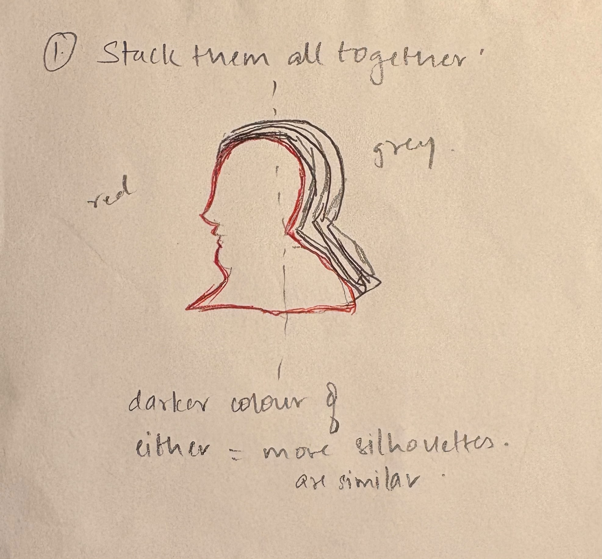
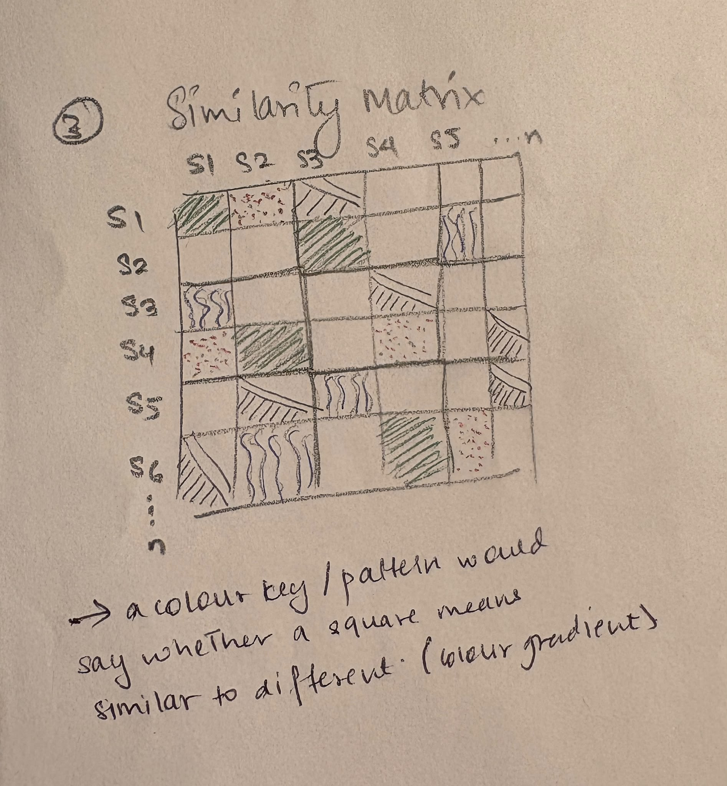
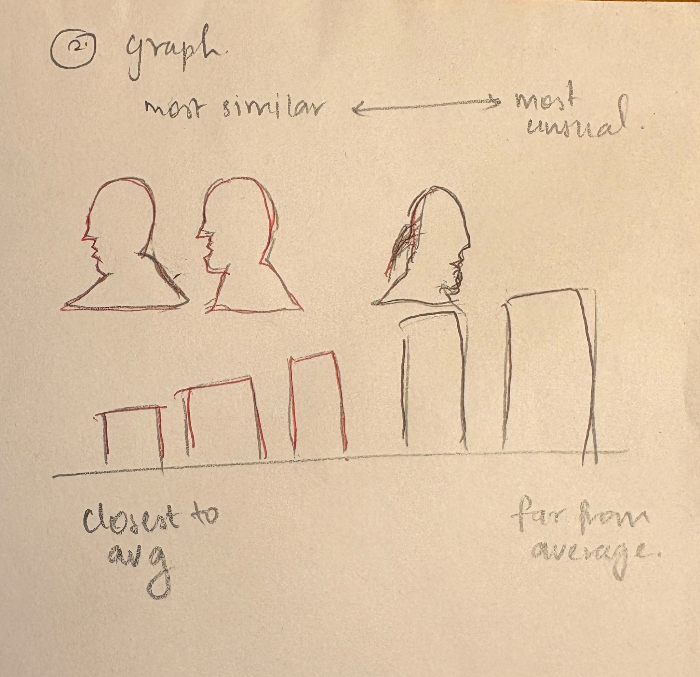

# Project-02

Project idea: How much do the silhouettes look alike?

This project explores how similar or different the historical silhouettes are from the Smithsonian US Revolutionary Era Collection. The notebook uses machine learning to group silhouettes by shape and comparisons to help people see patterns in the collection.

It uses the silhouettes’ x- and y-coordinate data and the eight groups created by a machine-learning method called K-means. Quantifiable aspects like how many silhouettes are in each group, how far each silhouette is from its group’s average shape, and the range of shape sizes can be shown. These measurements can show which groups are more alike and which have more variation.

Each Silhouette is visual record that can be compared by shape. There could be multiple ways to visualize this silhouette dataset, for example a bar chart, a distance chart or even a custom silhouette gallery. 

#Sketch 1: Silhouette Stack

This view layers many silhouettes on top of one another and places the collection’s average shape in the center. A tight cluster of outlines may suggest that many silhouettes have similar shapes; a wide spread may suggest more variation. The sketch explores the overall range of shapes in the collection.

#Sketch 2: Similarity Matrix

This view uses a colored square to represent each pair of silhouettes. Silhouettes are arranged by their machine-learning groups, so patterns of similar or different shapes may appear as blocks. A color key explains what the colors mean. This view can help show whether silhouettes in the same group are also similar to one another.

#Sketch 3: Typical to unsual

This view arranges real silhouettes from closest to farthest from their group’s average shape. It shows which examples are most similar to the average and which differ most according to the dot-position measurements. “Unusual” means far from the average shape; it does not mean historically unusual.

